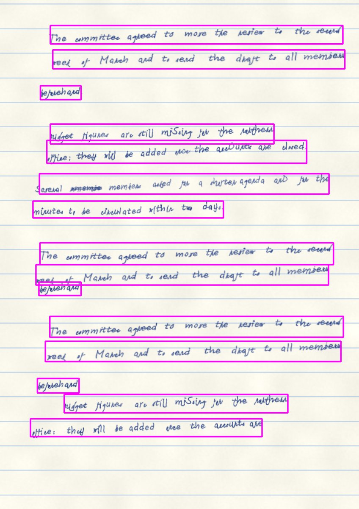

# hwdet: handwriting vs print detector for document pages

[](https://github.com/pavel9860/handwriting-print-detector/actions/workflows/ci.yml)
[](LICENSE)
[](NOTICE)


`hwdet` finds every **handwritten** and every **printed** text line on a document page, in **90 languages and
25 scripts**. It tells filled forms from blank ones, finds notes and signatures on printed pages and separates
handwritten pages from typeset ones, as a box detector (YOLO26s, 10 M parameters, about 0.3 s per page on a laptop CPU).

<p align="center"></p>

| | |
|---|---|
| Task | object detection, 2 classes: `0 handwriting`, `1 print` (one box per text line) |
| Model | `hwdet-s@1.0.0`: YOLO26s fine-tuned at 1024 px ([model card](MODEL_CARD.md)) |
| Data | 3,249 pages, 90 languages: synthetic handwriting on real documents plus 185 real handwritten pages ([dataset card](docs/DATASET.md)) |
| Validation | handwriting precision **0.948**, recall **0.924**, AP50 **0.963** (366 pages, IoU 0.5, conf 0.4); recall 0.71 on the 31 real handwritten pages |

## Install
```bash
pip install "hwdet[infer] @ git+https://github.com/pavel9860/handwriting-print-detector"
```
Weights are downloaded on first use from the GitHub release and checked against the sha256 in
[`models/registry.json`](models/registry.json) (cache: `~/.cache/hwdet`, override with `HWDET_CACHE`).

## Use
```python
from hwdet import Detector

det = Detector("hwdet-s")                      # latest version; pin with "hwdet-s@1.0.0" or pass a .pt / .onnx path
page = det.predict("scan.jpg")                 # path, PIL image or BGR array; a list gives a list
print(page.has_handwriting(), len(page.handwriting))
for b in page.boxes:                           # sorted by confidence
    print(b.label, b.conf, b.xyxy)
```
```bash
hwdet predict scan1.jpg scan2.png --json       # one JSON line per page
hwdet models list                              # registered models
hwdet predict scan.jpg --format onnx           # the released ONNX export, run by onnxruntime
hwdet export hwdet-s --format engine          # any Ultralytics export format (TensorRT, OpenVINO, CoreML, ...)
```
The detector resizes the long side to 1024 px (the training size). For a page-level decision
use `has_handwriting(min_boxes=2, min_conf=0.5)`; one weak box is the most common false alarm (see Limitations).

## Results
`hwdet-s@1.0.0` on the validation split of ds3k-3250-v3 (366 pages, 5,180 handwriting and 10,789 print lines;
reproduce with `hwdet eval hwdet-s DS --out metrics.json`).

| conf | IoU | class | precision | recall | F1 | FP / page | FN / page |
|---|---|---|---:|---:|---:|---:|---:|
| 0.4 | 0.5 | handwriting | **0.948** | **0.924** | 0.936 | 0.71 | 1.08 |
| 0.4 | 0.5 | print | 0.900 | 0.873 | 0.886 | 2.86 | 3.76 |
| 0.25 | 0.5 | handwriting | 0.919 | 0.938 | 0.928 | 1.18 | 0.88 |
| 0.25 | 0.5 | print | 0.856 | 0.894 | 0.875 | 4.43 | 3.12 |

mAP50 0.934, mAP50-95 0.687 (both classes, Ultralytics val); AP50 handwriting 0.963, print 0.905.

By page kind (handwriting class, conf 0.4, IoU 0.5):

| kind | pages | precision | recall | FP / page | FN / page | pages with ≤1 FP and ≤1 FN |
|---|---:|---:|---:|---:|---:|---:|
| filled forms (synthetic fill) | 113 | 0.956 | 0.959 | 0.74 | 0.70 | 80% |
| handwritten pages (synthetic) | 86 | 0.963 | 0.977 | 0.70 | 0.43 | 76% |
| notes on printed pages | 76 | 0.961 | 0.983 | 0.39 | 0.17 | 91% |
| print only (negatives) | 60 | – | – | 0.08 | 0.00 | 97% |
| **real handwritten pages** | 31 | 0.889 | 0.713 | 2.65 | 8.55 | 0% |

Read the numbers with care:
- Synthetic pages come from the same generators as training (different documents and writers). The only real
  handwriting is the `real_hw` row: 31 dense pages where recall drops to 0.71. Real pages are the weak point.
- An earlier model with 0.95 synthetic AP50 found handwriting on only 60 of 250 real filled forms; real-page
  recall is the open question (see [What to fix next](#what-to-fix-next)).

## Training data
Generated with two companion libraries (Apache-2.0):
[hwsynth](https://github.com/pavel9860/realistic_handwriting_153_scripts) writes natural handwriting in 153 scripts
(writer types, pens, motion model, scan look), and [ds-page-generation](https://github.com/pavel9860/ds-page-generation)
composes pages: real printed forms filled with answers in the form's language, reader notes on printed pages, full
handwritten pages of real text on 8 paper types, print-only negatives. 185 real handwritten pages from the corpus are
boxed automatically and checked. Every page is 768 x 1024, slightly skewed, with a scan look on part of them.
Details, counts and limits: [docs/DATASET.md](docs/DATASET.md).

## Train and evaluate
```bash
pip install -e ".[train]"
hwdet data manifest data/ds3k-3250-v3                       # content-hashed dataset version
hwdet train configs/train/hwdet-s.yaml --device 0,1         # runs/hwdet-s/{weights,metrics.json,run.json}
hwdet eval runs/hwdet-s/weights/best.pt data/ds3k-3250-v3
```
Each run records the git commit, package versions, the full recipe, the dataset version and the weight hashes in
`run.json`, and in MLflow when `MLFLOW_TRACKING_URI` is set. Recipe and release steps: [docs/TRAINING.md](docs/TRAINING.md).
Building the dataset itself needs the document corpus: `pip install -e ".[data]"`, then [scripts/dataset](scripts/README.md).

## Versioning
| what | scheme |
|---|---|
| code | SemVer `vX.Y.Z` tags, [CHANGELOG](CHANGELOG.md) |
| models | `name@version` in `models/registry.json`: major = labels / input / output change, minor = retrain on new data, patch = re-export; weights as release assets with sha256 |
| datasets | `hwdet data manifest`: sha256 over every image and label, recorded by every training run |

## Repository layout
```
src/hwdet/        predict.py (Detector), registry.py, train.py, evaluate.py, metrics.py, tracking.py, cli.py
src/hwdet/data/   detds.py, ds3k.py (set assembly), pack.py (validation, .npz shards), manifest.py
configs/train/    training recipes
models/           registry.json, metrics/ (weights are release assets)
datasets/         source lists of each released dataset
scripts/dataset/  dataset build / check / release drivers
docs/             DATASET.md, TRAINING.md, CORPUS_DETECTIONS.md
tests/            fast tests (no weights, no corpus); pytest -m slow runs the released model
```

## Limitations
- **Domain gap**: most handwriting in training is synthetic; real scans and phone photos with shadows, folds, stamps and
  very dense writing are the weakest cases.
- Print lines are found less reliably than handwriting (recall 0.87); dense tables and small print merge or split.
- Known confusions: decorative or script-like typefaces, Arabic print and pictograms read as handwriting; short
  handwritten entries inside form cells read as print.
- 25 scripts are written by hand in training; handwriting in other scripts is untested.
- Text lines only: no words, characters, signatures as a separate class, or reading order.

## What to fix next
1. **Real labelled test set** (300+ pages: filled forms, notes, letters, phone photos) to measure what matters;
   synthetic val cannot.
2. **More real handwriting in training**: pseudo-label the 489k handwriting boxes found in the 1.5 M-page corpus
   ([docs/CORPUS_DETECTIONS.md](docs/CORPUS_DETECTIONS.md)), review a sample, fine-tune.
3. Photo augmentations (perspective, shadows, blur, JPEG at low quality) and handwriting over print (signatures, strike-through).
4. Hard-negative mining for script-like fonts and Arabic print; calibrated page-level decision (`has_handwriting`)
   with a threshold chosen on the real test set.
5. Export and benchmark ONNX FP16 / TensorRT and OpenVINO INT8 with accuracy checks.

## License
Code and docs: [Apache-2.0](LICENSE): commercial use, modification and redistribution allowed with attribution
([NOTICE](NOTICE)). **Weights** are trained with Ultralytics YOLO and fall under **AGPL-3.0** (or an Ultralytics
Enterprise License); see [NOTICE](NOTICE) before deploying them.

## Citation
See [CITATION.cff](CITATION.cff). Contributions welcome: [CONTRIBUTING.md](CONTRIBUTING.md).
